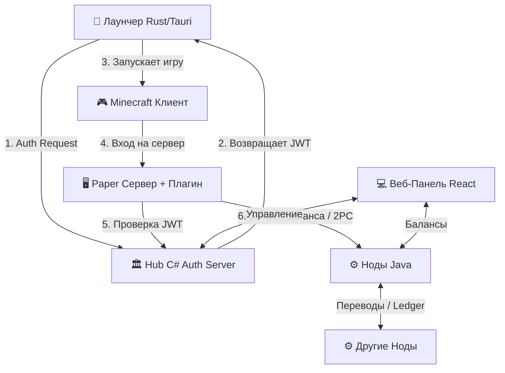

# 🍄 Sporelink Network

**Sporelink** — это открытая, федеративная экосистема для Minecraft, построенная с нуля. Мы объединяем независимые серверы в единую сеть с общей криптографической авторизацией, кросс-серверной экономикой и прозрачной репутацией.

[](https://github.com/sporelink-ru/hub)
[](https://github.com/sporelink-ru/connector)
[](https://github.com/sporelink-ru/launcher)
[](https://github.com/sporelink-ru/panel)

---

## 🌐 Архитектура

Sporelink не зависит от серверов Mojang. Вместо этого он использует **`authlib-injector`** и собственный протокол на базе JWT и подписей Ed25519, чтобы обеспечить безопасный вход.



## 📦 Репозитории

* **[Protocol](https://github.com/sporelink-ru/protocol)** — Спецификация федеративного протокола.
* **[Hub](https://github.com/sporelink-ru/hub)** — Auth-сервер (C#), совместимый с Yggdrasil (скины).
* **[Connector](https://github.com/sporelink-ru/connector)** — Экономические ноды (Java) с поддержкой 2PC (двухфазного коммита) и SQLite/PostgreSQL.
* **[Launcher](https://github.com/sporelink-ru/launcher)** — Кастомный лаунчер (Rust + Tauri) с 3D-скинами и логами.
* **[Panel](https://github.com/sporelink-ru/panel)** — Веб-интерфейс (React) для игроков и админов.
* **[Plugin](https://github.com/sporelink-ru/plugin)** — Плагин для Paper (команды `/pay`, `/shop`).
* **[Infra](https://github.com/sporelink-ru/infra)** — Docker Compose для мгновенного развертывания.

## 🚀 Быстрый старт

Вся сеть поднимается одной командой:

```bash
git clone https://github.com/sporelink-ru/infra.git
cd infra
docker compose up -d --build
```

После запуска:
* 🌐 **Панель управления**: `http://localhost:3000` (Логин: `ceo`, Пароль: `ceo`)
* 🔑 **Auth-сервер**: `http://localhost:5000`
* ⚙️ **Ноды**: `http://localhost:8080` (Node A) и `8081` (Node B)

## 🔒 Безопасность

Вся передача данных между компонентами защищена цифровыми подписями.
* **JWT** подписываются алгоритмом `Ed25519`.
* **Скины** проверяются через `RSA SHA1` (в соответствии со стандартом Mojang).
* **Транзакции** (2PC) между нодами имеют защиту от повторного воспроизведения (timestamp window) и зависших состояний (автоматический recovery).